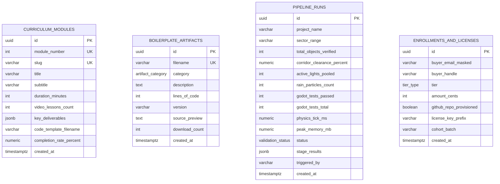

# MomentumForge AI — Database Schema, Type System & Validation Architecture

**Project:** MomentumForge AI ("The Autonomous Blender-to-Godot Agentic GameDev Boilerplate, Masterclass & CI/CD Pipeline Platform")  
**ORM / Target RDBMS:** Drizzle ORM (`drizzle-orm/pg-core`) on PostgreSQL 16  
**Backend Validation Layer:** Python Pydantic v2 (`models/schemas.py`)  
**Frontend / BFF Type Layer:** TypeScript Strict Interfaces (`types/index.ts`)

---

## 1. Entity-Relationship Overview

---

## 2. PostgreSQL Enums (`db/schema.ts`)

| Enum Name | Values | Purpose |
| :--- | :--- | :--- |
| `tier_type` (`tierTypeEnum`) | `'STARTER_KIT'`, `'COHORT_BOOTCAMP'`, `'STUDIO_LICENSE'`, `'SAAS_PRO_PIPELINE'` | 4-tier commercial product & SaaS funnel classification |
| `pipeline_stage` (`pipelineStageEnum`) | `'BLENDER_MCP_GEN'`, `'KDTREE_CORRIDOR_AUDIT'`, `'CONTRACT_VALIDATION'`, `'VISUAL_QA_LOOP'`, `'GLTF_CHUNK_EXPORT'`, `'GODOT_HEADLESS_TEST'` | 6-stage deterministic Blender-to-Godot CI/CD pipeline stages |
| `validation_status` (`validationStatusEnum`) | `'PASSED'`, `'WARNING'`, `'FAILED'`, `'RUNNING'` | Execution status of an overall pipeline run or individual stage |
| `artifact_category` (`artifactCategoryEnum`) | `'BPY_HARNESS'`, `'JSON_CONTRACT'`, `'AGENT_SKILL'`, `'GODOT_RUNTIME'`, `'GDSCRIPT_TEST'` | Classification of production boilerplate files in the kit |

---

## 3. Table Specifications

### 3.1 `curriculum_modules`
Stores the 8-week Cohort Bootcamp & Masterclass syllabus built from real `Momentum` production milestones.
- `id`: `UUID` Primary Key (`defaultRandom()`)
- `module_number`: `integer` (`NOT NULL`, Unique Index) — Week/Module order (1–8)
- `slug`: `varchar(120)` (`NOT NULL`, Unique Index) — URL-safe identifier
- `title`: `varchar(180)` (`NOT NULL`)
- `subtitle`: `varchar(320)` (`NOT NULL`)
- `duration_minutes`: `integer` (`NOT NULL`)
- `video_lessons_count`: `integer` (`NOT NULL`)
- `key_deliverables`: `jsonb` (`string[]`, `NOT NULL`)
- `code_template_filename`: `varchar(160)` (`NOT NULL`)
- `completion_rate_percent`: `numeric(5, 2)` (`NOT NULL`)
- `created_at`: `timestamptz` (`defaultNow()`, `NOT NULL`)

### 3.2 `boilerplate_artifacts`
Stores inspectable source artifacts included in the **Agentic GameDev Boilerplate & Starter Kit ($149)**.
- `id`: `UUID` Primary Key (`defaultRandom()`)
- `filename`: `varchar(180)` (`NOT NULL`, Unique Index) — e.g., `bpy_corridor_kdtree_audit.py`, `scene_contract.schema.json`, `ChunkStreamer3D.gd`
- `category`: `artifactCategoryEnum` (`NOT NULL`, Indexed)
- `description`: `text` (`NOT NULL`)
- `lines_of_code`: `integer` (`NOT NULL`)
- `version`: `varchar(32)` (`NOT NULL`) — Semantic version tag (e.g., `v2.4.0`)
- `source_preview`: `text` (`NOT NULL`) — Real, syntax-highlighted production code preview
- `download_count`: `integer` (`NOT NULL`, Default `0`)
- `created_at`: `timestamptz` (`defaultNow()`, `NOT NULL`)

### 3.3 `pipeline_runs`
Stores telemetry and stage-by-stage verification logs for the **Blender-to-Godot CI/CD Pipeline Simulator**.
- `id`: `UUID` Primary Key (`defaultRandom()`)
- `project_name`: `varchar(140)` (`NOT NULL`)
- `sector_range`: `varchar(80)` (`NOT NULL`) — e.g., `'S00-S60 (54.89 km)'`
- `total_objects_verified`: `integer` (`NOT NULL`) — e.g., `2056`
- `corridor_clearance_percent`: `numeric(5, 2)` (`NOT NULL`) — e.g., `100.00`
- `active_lights_pooled`: `integer` (`NOT NULL`) — e.g., `8`
- `rain_particles_count`: `integer` (`NOT NULL`) — e.g., `14000`
- `godot_tests_passed`: `integer` (`NOT NULL`) — e.g., `19`
- `godot_tests_total`: `integer` (`NOT NULL`) — e.g., `19`
- `physics_tick_ms`: `numeric(6, 3)` (`NOT NULL`) — e.g., `2.410` ms (120Hz budget is 8.333ms)
- `peak_memory_mb`: `numeric(6, 1)` (`NOT NULL`) — e.g., `412.8` MB
- `status`: `validationStatusEnum` (`NOT NULL`, Indexed)
- `stage_results`: `jsonb` (`PipelineStageResultRecord[]`, `NOT NULL`)
- `triggered_by`: `varchar(120)` (`NOT NULL`)
- `created_at`: `timestamptz` (`defaultNow()`, `NOT NULL`, Indexed)

### 3.4 `enrollments_and_licenses`
Tracks commercial license checkouts, cohort enrollments, and SaaS subscriptions across the 4-tier funnel.
- `id`: `UUID` Primary Key (`defaultRandom()`)
- `buyer_email_masked`: `varchar(160)` (`NOT NULL`) — Strictly masked PII (`d***@studio.dev`)
- `buyer_handle`: `varchar(80)` (`NOT NULL`)
- `tier`: `tierTypeEnum` (`NOT NULL`, Indexed)
- `amount_cents`: `integer` (`NOT NULL`) — Integer cents precision (`14900`, `79900`, `249900`, `4900`)
- `github_repo_provisioned`: `boolean` (`NOT NULL`, Default `true`)
- `license_key_prefix`: `varchar(64)` (`NOT NULL`) — Masked key prefix (`mf_live_9a8f12c4...`)
- `cohort_batch`: `varchar(64)` (`NULLABLE`)
- `created_at`: `timestamptz` (`defaultNow()`, `NOT NULL`, Indexed)

---

## 4. Security & Validation Guarantees (`models/schemas.py`)

1. **Zero Raw PII Persistence:** `LicenseCheckoutRequest` validates the incoming email syntax and `mask_buyer_email()` immediately masks the local part (`d***@studio.dev`) before persistence or API response serialization.
2. **Integer Cents Financial Precision:** All monetary values in `enrollments_and_licenses` are stored as `amount_cents` (`int`) to eliminate IEEE 754 floating-point drift.
3. **Strict Input Sanitization:** Every Pydantic v2 request schema sets `ConfigDict(extra="forbid")`, enforces `min_length`/`max_length`, numeric bounds (`ge`/`le`), and strict allow-list regular expressions on filenames, handles, slugs, and sector bounds.
